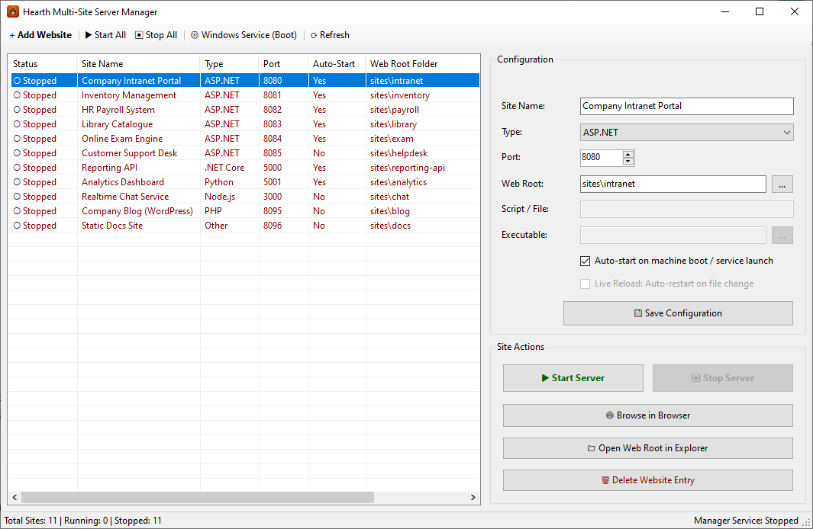
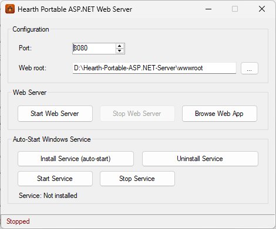

# Hearth Portable Web Server

**Hearth** is a lightweight, high-performance, zero-install portable web server for Windows.

Built natively for **ASP.NET Web Forms (.NET Framework 4.8)** without requiring Windows IIS, Hearth also includes a **Multi-Site Manager** capable of running **ASP.NET, PHP, Python, Node.js, and .NET Core** websites side-by-side from a single folder or USB drive.

---

## Download

Download the latest release from the [**GitHub Releases Page**](https://github.com/ASP-NET-Web-Forms-Club/Hearth-ASPNET-Server/releases):

| Release Package | Size | Best For |
| :--- | :--- | :--- |
| **`HearthPortableWebServer.1.4-bundled-runtime-php-python-nodejs.zip`** | **90.5 MB** | **All-in-One Bundle (Recommended for instant setup)** Includes **ASP.NET** (built-in default) plus pre-configured, portable **PHP, Python, and Node.js** runtimes and sample demo sites that work out of the box with zero installation. |
| **`HearthPortableWebServer.1.4.zip`** | **224 KB** | **Lightweight Launcher Only** Supports **ASP.NET** out of the box. To run PHP, Python, Node.js, or .NET Core sites, install the desired runtime on your machine (or provide your own runtime folder) and point to the executable path if not on your system `PATH`. |

---

## Screenshots

### Multi-Site Manager (`HearthPortableWebServer.Manager.exe`)
Manage and run multiple websites across different languages and ports simultaneously:

### Single-Site Launcher (`HearthPortableWebServer.Launcher.exe`)
Quick, one-click launcher dedicated to a single ASP.NET website:

---

## What Can Hearth Do?

* **Run ASP.NET Without IIS**: Host classic ASP.NET Web Forms (`.aspx`, `.ashx`, `.asmx`, `Web.config`, `bin\`) directly on any Windows PC (including Windows Home editions) with **no IIS installation** and **no Administrator privileges** required for local hosting.
* **Host Multiple Runtimes Side-by-Side**: Run **ASP.NET**, **PHP**, **Python**, **Node.js**, **.NET Core**, or custom executables simultaneously on separate ports from one dashboard.
* **100% Portable (Zero Registry / System Footprint)**: Move the folder anywhere or run it off a USB drive. Delete the folder when you are done—nothing is left behind on the host system.
* **Smart Runtime Discovery**: Automatically detects project virtual environments (such as Python `.venv`), bundled runtimes (`runtimes\php`, `runtimes\python`, `runtimes\node`), or your system `PATH`.
* **Live Reload on File Change**: Automatically restarts your site when code or configuration files (`.py`, `.js`, `.php`, `.cs`, `Web.config`, `bin\*.dll`) are modified.
* **Run at Windows Boot (Windows Service Support)**: Optionally install either the Multi-Site Manager or the Single-Site Launcher as a background Windows Service so your websites start automatically when the PC boots—even before any user logs in—and recover automatically if a process crashes.
* **High Performance**: Built directly on the Windows `HTTP.sys` kernel driver and `HttpRuntime.ProcessRequest`, delivering ~16% higher dynamic throughput than stock single-worker IIS (peaking at **14,980 requests/sec**).

---

## How to Use

### Option 1: Multi-Site Manager (Recommended for Multiple Sites or PHP / Python / Node.js)
1. Extract your downloaded `.zip` archive to any folder.
2. Double-click **`HearthPortableWebServer.Manager.exe`**.
3. **To run an existing site**: Select a site from the list and click **▶ Start Server** (or click **▶▶ Start All Sites**), then click **🌐 Browse in Browser**.
4. **To add your own website**:
   * Click **+ Add Website**.
   * Enter a **Site Name**, choose the **Type** (`ASP.NET`, `PHP`, `Python`, `Node.js`, `.NET Core`, or `Other`), and pick a **Port**.
   * Set the **Web Root** to your website's folder.
   * For **Python** or **Node.js**, specify your entry script (e.g., `app.py` or `server.js`).
   * Leave the **Exe (opt)** field blank to automatically use the bundled runtime or system `PATH` (or browse to a custom runtime executable if using the lightweight release without a system install).
   * Click **💾 Save Configuration**, then **▶ Start Server**.

### Option 2: Single-Site Launcher (Quick Single ASP.NET Site)
1. Place your ASP.NET Web Forms application files inside the **`wwwroot`** folder (or any folder of your choice).
2. Double-click **`HearthPortableWebServer.Launcher.exe`**.
3. Choose your **Port** (default `8080`) and **Web Root**, then click **Start Web Server** and **Browse Web App**.

### Option 3: Auto-Start on Windows Boot (Windows Service)
Normally, servers run while you start them from the app. If you want your websites to run 24/7 in the background—starting automatically at machine boot before anyone logs in, and staying online when you close the app:
* **In Multi-Site Manager**: Check **"Auto-start on machine boot / service launch"** on the sites you want to run at boot, click **Save Configuration**, then click **⚙ Windows Service (Boot)** → **Install Service**.
* **In Single-Site Launcher**: Click **Install Service** directly in the launcher window.

---

## Why Use Hearth Instead of Full Windows IIS?

| Feature | Windows IIS | Hearth Portable Web Server |
| :--- | :--- | :--- |
| **Installation** | Requires enabling OS features (`dism` / Turn Windows features on or off). | **Unzip and run.** Zero installation required. |
| **Administrator Rights** | Required to create sites, configure app pools, and edit bindings. | **Runs as a standard user** on `localhost` (Admin only needed if installing as a Windows Service or binding to external network IPs). |
| **Multi-Language Support** | Requires manual FastCGI / HttpPlatformHandler module setup for PHP, Python, and Node.js. | **Built-in multi-engine support** (and pre-bundled in the All-in-One release). |
| **Desktop / Kiosk App Bundling** | Difficult to ship inside a self-contained customer installer. | **Ideal "App-in-a-Box" server** for POS systems, local web tools, and offline appliances. |

---

## Technical Documentation & Benchmarks

For in-depth technical details—including internal architecture, command-line (`Host.exe`) arguments, `Web.config` compatibility, and the full IIS vs. Hearth performance benchmark report—visit the [**Hearth Project Wiki**](https://github.com/ASP-NET-Web-Forms-Club/Hearth-ASPNET-Server/wiki):

* 📖 [**Hearth Wiki Home & Technical Guide**](https://github.com/ASP-NET-Web-Forms-Club/Hearth-ASPNET-Server/wiki)
* ⚡ [**Performance Benchmark Report (Hearth vs. IIS)**](https://github.com/ASP-NET-Web-Forms-Club/Hearth-ASPNET-Server/wiki/Performance-Benchmark)
* 📦 [**Download Releases**](https://github.com/ASP-NET-Web-Forms-Club/Hearth-ASPNET-Server/releases)
